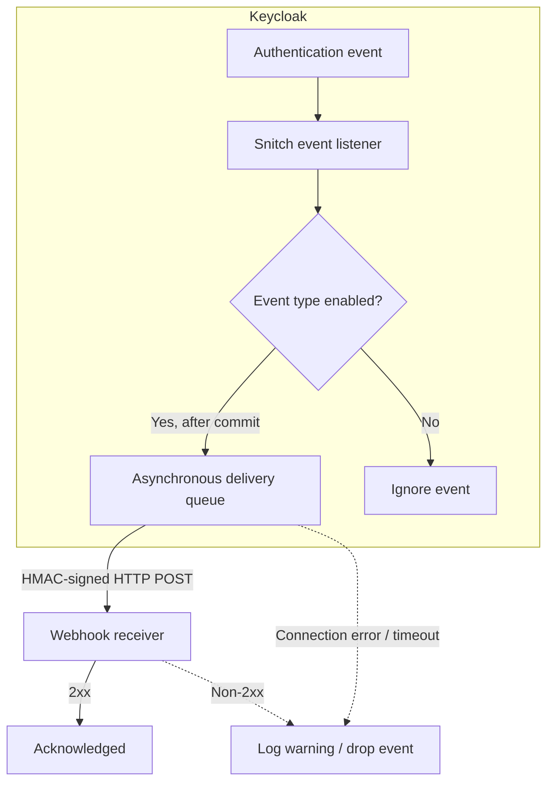

# Keycloak Snitch

<p align="center">
  
</p>

Keycloak Snitch sends Keycloak user and administrative events to an HTTP webhook. It runs as a Keycloak event listener and works with receivers such as [Keycloak Warden](https://github.com/gi8lino/keycloak-warden).



## Try it locally

Use the **E2E Docker Compose stack** to start Keycloak with Snitch and [Hookglass](https://github.com/gi8lino/hookglass), which validates HMAC-signed webhooks before logging them:

```sh
make e2e-up       # Build and start Keycloak and Hookglass; print the realm URL
make e2e-logs     # Follow Keycloak and verified webhook logs
make e2e-test     # Reset and verify real logins, token refresh, admin events, and an outage
make e2e-down     # Stop the stack
```

Open the [E2E demo account](http://127.0.0.1:18083/realms/keycloak-snitch-e2e/account/) (or the account URL printed by `make e2e-up`) and sign in as `demo`:

- A wrong password produces `LOGIN_ERROR`.
- Password `dev-password` produces `LOGIN`.

The test realm, the `smoke` OAuth client, and the `snitch` listener are defined in [`test/e2e/realm/keycloak-snitch-e2e.json`](test/e2e/realm/keycloak-snitch-e2e.json).

The Keycloak admin console is at [http://127.0.0.1:18083/admin/master/console/](http://127.0.0.1:18083/admin/master/console/) with `dev-admin` / `dev-admin-password`. Override the host port with `make e2e-up E2E_KC_PORT=18183`.

See the [E2E guide](test/e2e/README.md) for the full workflow. These are **development-only** credentials and HTTP endpoints; do not use them in production.

## Install

1. Download the JAR from [Releases](https://github.com/gi8lino/keycloak-snitch/releases) or build it with `make build` (JDK 21 and Maven required).
2. Copy `keycloak-snitch-<version>.jar` into Keycloak's `/opt/keycloak/providers/` directory on **every Keycloak node**.
3. For an optimized installation, run `bin/kc.sh build` with the JAR in place before starting Keycloak.
4. In each realm, go to **Realm settings → Events → Event listeners**, add `snitch`, and save.

Use a Snitch build compatible with your Keycloak version. The event listener SPI is internal to Keycloak and may change between releases. Administrative forwarding is opt-in.

## Keycloak event settings

Keycloak distinguishes between event listeners and event storage under **Realm settings → Events**:

- **Event listeners** — Add `snitch` to enable forwarding for a realm.
- **Save events / Saved types** — Control which events Keycloak stores in its database. These settings do not filter events delivered to Snitch.
- **Snitch `EVENT_TYPES`** — Controls which received events Snitch forwards to the webhook. This SPI setting applies to all realms using Snitch.

**Event storage does not need to be enabled for Snitch to work.** Register the listener in the desired realms and configure the event types globally.

## Configuration

Set the following environment variables **on Keycloak**:

```dotenv
KC_SPI_EVENTS_LISTENER__SNITCH__WEBHOOK_URL=https://warden.example.com/events
KC_SPI_EVENTS_LISTENER__SNITCH__WEBHOOK_SECRET=replace-with-a-strong-shared-secret
KC_SPI_EVENTS_LISTENER__SNITCH__EVENT_TYPES=LOGIN_ERROR
```

The webhook URL and shared secret are required. Configure the same secret on the receiver. HTTPS is recommended for production; redirects are not followed.

Optional settings (defaults in parentheses):

- `KC_SPI_EVENTS_LISTENER__SNITCH__EVENT_TYPES` — Events to forward (`LOGIN_ERROR`).
- `KC_SPI_EVENTS_LISTENER__SNITCH__ADMIN_EVENTS` — Forward administrative events (`false`).
- `KC_SPI_EVENTS_LISTENER__SNITCH__CONNECT_TIMEOUT_MS` — Connection timeout (`1000` ms).
- `KC_SPI_EVENTS_LISTENER__SNITCH__REQUEST_TIMEOUT_MS` — Request timeout (`2000` ms).
- `KC_SPI_EVENTS_LISTENER__SNITCH__QUEUE_SIZE` — Pending events per Keycloak instance (`256`, plus one in flight).

Set `EVENT_TYPES` to an empty string and enable `ADMIN_EVENTS` for administrative-only monitoring. At least one event category must be enabled. Timeouts and queue size must be positive. You can also use `keycloak.conf` with the `spi-events-listener--snitch--` prefix, for example:

```properties
spi-events-listener--snitch--webhook-url=https://warden.example.com/events
```

A missing or invalid required setting prevents Keycloak from starting. A temporarily unavailable receiver does not prevent Keycloak logins.

## Webhook format

Snitch sends one JSON object per HTTP POST (`Content-Type: application/json`).

### User event

```json
{
  "schemaVersion": 2,
  "id": "bb685023-a081-4423-be47-0d40fe4aa59c",
  "source": "keycloak",
  "kind": "user",
  "timestamp": "2026-11-05T14:30:00Z",
  "user": {
    "type": "LOGIN_ERROR",
    "realmId": "example",
    "clientId": "application",
    "userId": null,
    "ipAddress": "203.0.113.42",
    "error": "invalid_user_credentials"
  }
}
```

The envelope includes the five common metadata fields and exactly one event object. For `kind: "user"`, `user` contains the native event type and identity fields. Unknown identity fields and `error` may be `null`. The event ID supports deduplication. Configure Keycloak trusted proxies correctly so the reported client IP is reliable.

### Administrative event

```json
{
  "schemaVersion": 2,
  "id": "ea9fc922-39e3-48d5-8d80-ef3aa801c36f",
  "source": "keycloak",
  "kind": "admin",
  "timestamp": "2026-11-05T14:35:00Z",
  "admin": {
    "realmId": "example",
    "operationType": "CREATE",
    "resourceType": "REALM_ROLE_MAPPING",
    "resourcePath": "users/example-user/role-mappings/realm",
    "actor": {
      "realmId": "master",
      "clientId": "admin-client-id",
      "userId": "administrator-id",
      "ipAddress": "203.0.113.42"
    },
    "error": null
  }
}
```

For `kind: "admin"`, `admin.realmId` is the affected realm. `admin.actor` contains the administrator’s authentication realm, native Keycloak client ID, user ID and IP address; it can be `null` when authentication details are unavailable. The `user` object is absent. Resource representations and arbitrary event details are never forwarded.

Enable `KC_SPI_EVENTS_LISTENER__SNITCH__ADMIN_EVENTS=true` to forward administrative events. Both categories share the best-effort delivery queue.

### Verify the signature

Every request includes:

- `X-Snitch-Timestamp` — Unix delivery time in seconds.
- `X-Snitch-Signature` — `v1=` followed by a lowercase hexadecimal HMAC-SHA256 digest.

Calculate the HMAC using the shared secret and the **raw request body** (before decoding JSON):

```text
HMAC-SHA256(secret, timestamp + "." + rawBody)
```

Compare the decoded digest in constant time, reject old timestamps, and deduplicate event IDs. The included Hookglass configuration accepts a five-minute timestamp window and bodies up to 64 KiB. Return a `2xx` HTTP status to acknowledge delivery.

## Delivery behavior

Snitch queues events after their Keycloak transaction commits and sends them asynchronously, so webhook latency does not block logins. Rolled-back events are discarded.

**Delivery is best effort:** there is no persistent queue or retry. A full queue, timeout, or receiver error can lose an event. On shutdown, Snitch waits up to three seconds for queued deliveries to finish, then interrupts any remaining work. Events may still be lost. Monitor Keycloak warnings and size the queue for your load. Warnings and shutdown summaries include per-instance accepted, delivered, failed and dropped counters. These are log diagnostics, not Prometheus collectors.

## Kubernetes

The recommended approach is to bake the JAR into a Keycloak image matching your Keycloak version, before the optimized build.

Alternatively, mount the JAR from a PVC into `/opt/keycloak/providers/` using a single-file `subPath` mount. Put the file at `providers/keycloak-snitch-<version>.jar` on the PVC, then mount it at the same path under `/opt/keycloak/providers/`. The file must be readable by Keycloak, and optimized images must be built with the provider installed.

Store the shared secret in a Kubernetes Secret, use HTTPS for external webhooks, and configure the same settings on every Keycloak replica.

## Development

```sh
make build                  # Build and test the JAR
make test                   # Java unit tests
make check                  # Java tests and E2E shell syntax
make verify                 # All local checks (no Docker)
make e2e-test               # Real Keycloak / Hookglass integration test
make e2e-logs               # Follow E2E Keycloak and Hookglass logs
make e2e-down               # Stop the E2E stack
make version VERSION=0.2.0  # Set the next JAR version
make clean                  # Remove build outputs
```

The E2E test requires Docker Compose and `curl`; no Python or `jq` is needed. Tagged releases publish a versioned JAR to GitHub Releases.

## License

Licensed under the [Apache License, Version 2.0](LICENSE).
